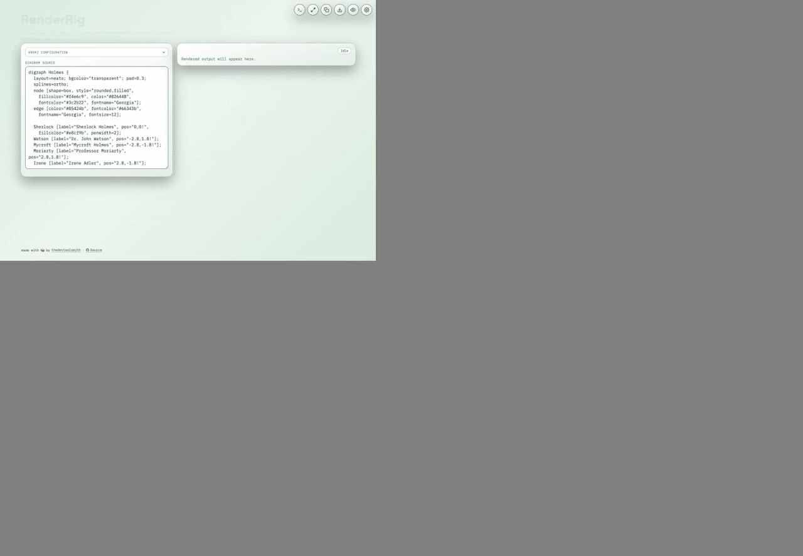

# RenderRig

**Write diagrams as text. Preview them live. Host it yourself.**

RenderRig is a lightweight, self-hostable web workspace for [Kroki](https://kroki.io/). Kroki is an [open-source API](https://github.com/yuzutech/kroki) that lets you turn text into architecture diagrams, flowcharts, and sequence diagrams without switching between separate tools. It supports around [30 diagramming languages](https://kroki.io/#support). This project is a UI for Kroki which lets you edit source and see the result side by side, then export an image.



## Why RenderRig?

- There is no good modern front-end for [Kroki](https://kroki.io), last I checked.
- The entire stack is self-hostable.

## Deploy in one command

With Docker running and Docker Compose installed, run this from the cloned repository:

```bash
docker compose up -d
```

Open **[http://127.0.0.1:8080](http://127.0.0.1:8080)**. The stack starts the frontend, Kroki, and a proxy; RenderRig connects to the bundled backend automatically.

## Documentation

- [Deployment](docs/deployment.md) — Docker, Podman, scaling, and frontend-only setup.
- [Using RenderRig](docs/usage.md) — shortcuts, sharing, export, and configuration.
